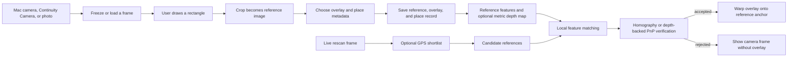

# Stitch: visual recognition and depth-aware AR

The main deliverable is [the IIT Roorkee LaTeX report](report/thesis.pdf), with [source](report/main.tex), [IITR presentation PDF](presentation/Stitch_IITR_Presentation.pdf), [PowerPoint](presentation/Stitch_IITR_Presentation.pptx), [comparison video](demo/comparison.mp4), and [GIF](demo/comparison.gif). It uses PRONOB BHATTACHARJEE, enrollment 25565017, and the user-confirmed supervisor Dr. R. Balasubramanian. Certification remains unsigned for review.

`report/thesis.pdf` is the short edition (88 pages): core chapters, results, deployment, ethics, conclusion and reproduction instructions. The complete 254-page edition is kept as `report/thesis_full.pdf`; set `\FullReporttrue` in `report/main.tex` to rebuild it. The complete edition adds projective derivations, decision analysis, failure diagnosis, reliability and persistent-AR transaction design, plus a complete atlas of 24 HPatches sequences and 24 Tokyo sites and a 612-row oracle-pair register. Atlas photographs and numbers come from the frozen experiment files; proposed service designs are explicitly distinguished from implemented results. `scripts/generate_extended_evidence.py` regenerates the atlas during `make thesis`.

This extension compares SIFT + FLANN, pretrained SuperPoint + LightGlue, CosPlace retrieval, and retrieval → learned matching → RANSAC → posted-content rendering. The original `tep.py`, `tep2.py`, and `tep3.py` remain byte-for-byte unchanged. Their README is preserved in `docs/UPSTREAM_README.md`.

## Setup and data

Use CPython 3.9–3.12. Setup selects an available supported interpreter; the tested Mac uses `/usr/bin/python3` (3.9.6). Packages install into the project-local environment.

```sh
bash scripts/setup.sh
```

Download and verify the fixed public subsets, then generate seeded queries:

```sh
make data
```

Inputs: 24 HPatches sequences (144 images, 120 homography pairs), 96 real Tokyo photographs from 24 sites, and 90 synthetic queries from six sources. HPatches uses the author's reachable mirror after the original host failed DNS resolution. Tokyo uses CRC-checked partial ZIP downloads; all 315 CSV records are retained. Subsequent runs verify SHA256 and skip valid data; missing inputs can be restored against the pinned manifest.

Tokyo is a **custom cross-time query-to-query protocol**, not the official street-view benchmark. Day→day changes viewing direction; the other Tokyo splits retain front-facing direction across time. Synthetic night/fog are simulated and reported separately.

## Experiments

Each command records exact arguments, exit code, duration and output in `results/commands.jsonl` and `results/logs/`.

```sh
# Original scripts: bounded headless file adapter, same 90 frames
.venv/bin/python scripts/run_logged.py .venv/bin/python scripts/run_originals.py --limit 90

# All A–D methods, exhaustive local search and shortlist/verification ablations
.venv/bin/python scripts/run_logged.py .venv/bin/python scripts/evaluate.py --learned-exhaustive

# Frozen 512→128 projection, with/without night augmentation, three seeds
.venv/bin/python scripts/run_logged.py .venv/bin/python scripts/train.py --steps 120

# Actual global-only ONNX export, QDQ INT8 calibration, parity and retrieval
.venv/bin/python scripts/run_logged.py .venv/bin/python scripts/export_models.py

# Actual point correspondences for qualitative figures
.venv/bin/python scripts/run_logged.py .venv/bin/python scripts/qualitative.py

# Real day/night stills with labelled generated camera motion, both pipelines
.venv/bin/python scripts/run_logged.py .venv/bin/python scripts/demo.py

# Isolated wall-clock latency, rendering and complete-process peak RSS
.venv/bin/python scripts/run_logged.py .venv/bin/python scripts/benchmark_runtime.py

# Geometry, matching, rendering, coordinates and cache-consistency tests
.venv/bin/python scripts/run_logged.py .venv/bin/python -m pytest -q
```

Run heavy inference sequentially for latency comparisons. Evaluation `stage_sum_ms` sums measured stage costs with cached references; complete-query latency comes from the separate isolated profiles. Optional training uses eight HPatches training identities, sixteen held-out identities and no Tokyo training images. It updates only a projection head. The main comparison uses the original pretrained descriptor.

## Thesis build

TeX Live/MacTeX, `latexmk`, BibTeX and MakeIndex must be on `PATH`; these were already installed on the tested host.

```sh
make thesis
```

This generates tables/macros and vector plots from measured results, compiles the report, writes `report/thesis.pdf`, and verifies the log, references, provenance, aggregates and demo decoding. For a clean TeX build:

```sh
make clean
make thesis
```

`results/final_verification.json` records PDF/chapter page counts, unresolved-reference checks and the PDF hash. The revised layout follows the supplied PRONOB BHATTACHARJEE IITR reference: A4, 11 pt Latin Modern, 1.5 spacing, binding margin, right italic headers, blue links, two crest-bearing cover pages and matching front matter. Change `report/preamble.tex` and `branding/project_metadata.tex`. The previous generic report is preserved under `report/previous/`. Generated tables are in `report/tables/`, plots in `figures/` and `report/figures/`.

## IITR presentation and self-contained source packages

The 4:3 Beamer deck uses the original `beamerthemeIITR.sty`, crests, campus photograph, lion watermark and blue framing from the supplied `IITR_template`. All figures/numbers come from the measured Stitch results.

```sh
make presentation
.venv/bin/python scripts/run_logged.py .venv/bin/python scripts/verify_iitr_documents.py
.venv/bin/python scripts/run_logged.py .venv/bin/python scripts/package_iitr_documents.py
```

Use `make package` to regenerate both documents, verify them and refresh every file in `deliverables/`. Use `make check-documents` to check the documents and compile both delivered ZIPs in fresh temporary directories.

`make -j package` preserves report-before-presentation order so the slides use the newly generated results. Document checks can use the saved reference-layout fingerprint in `branding/reference_layout.json` when the original reference PDF is absent.

The optional PowerPoint export dependency is in `requirements-presentation.txt` and included in the main setup requirements. The `.pptx` preserves the LaTeX layout as full-slide images with extracted text in speaker notes; edit the `.tex` master to change slide text. `deliverables/` contains the report PDF, presentation PDF/PPTX and separate complete LaTeX ZIPs. Both ZIPs include all required assets and compile independently with pdfLaTeX/latexmk, without downloading datasets or models. See `results/iitr_assets.json` for artwork provenance and `results/iitr_documents_verification.json` for checks.

## Register, scan and recognize

### Project pipeline

Stitch stores a user-selected crop as a visual reference and can optionally save
a metric depth map and 3D overlay anchor with it. During a rescan, it finds the
reference, verifies its camera pose or planar homography, then projects the saved
overlay onto the corresponding scene location.



#### 1. Register a reference

1. Connect the Mac camera, select another camera source (including iPhone
   Continuity Camera), or load a photo.
2. Freeze a camera frame (or use the loaded photo) and draw a rectangle around
   a textured scene region. That crop becomes the recognition reference; include
   stable landmarks around the intended placement. The planar modes work best
   with a flat surface, while `depth3d` can use depth variation in a wider scene.
3. The Register screen previews SIFT keypoints at the scan resolution. A low
   count suggests choosing a larger, more textured region.
4. Choose the overlay image and enter a place ID, name, and latitude/longitude.
   Registering saves the crop and overlay under `data/assets/` and records their
   paths and capture metadata in `data/places.json`.

Each registered view has its own reference image and overlay. In planar modes,
the default overlay anchor covers the whole selected crop; the CLI also accepts
a custom normalized four-corner anchor. In 3D mode, the second box drawn on the
depth preview defines the overlay plane.

#### 2. Find a registered surface

For each rescan frame, Stitch extracts local features from the query and
candidate reference images and matches their descriptors. Planar modes estimate
a reference-to-camera homography with RANSAC. `depth3d` unprojects reference
matches with the saved depth map and estimates the camera pose with PnP RANSAC.
It rejects a candidate unless the match count, inlier ratio, and geometry checks
pass.
When scan GPS is supplied, nearby registered places are added to the candidate
shortlist; image matching and geometric verification are still required.

The matching modes are:

| Mode | Candidate selection | Local matching |
| --- | --- | --- |
| `classical` | All references | SIFT descriptors with FLANN matching |
| `local` | All references | SuperPoint features with LightGlue |
| `full` | CosPlace global descriptor shortlist, plus nearby GPS candidates when supplied | SuperPoint features with LightGlue |
| `depth3d` | All references | SIFT correspondences, reference depth, and PnP camera-pose recovery |

`classical` is the default in the desktop app and does not need a global index.
`full` requires the CosPlace model and a current descriptor index. Rebuild that
index after changing references with `.venv/bin/stitch index data/places.json`.

#### Optional depth-backed 3D placement

Install the optional model runtime once:

```sh
.venv/bin/pip install -r requirements-depth.txt
```

In the **3D placement** tab, select a reference in Register, set the horizontal
camera FOV, the **rescan range** (total degrees people may stand around the
spot) and the **per-view tolerance**, then click **Generate depth map and select
3D overlay box**. Use the same camera and calibrated FOV for every view.

1. **First view (0°).** The app estimates metric depth for the selected
   reference crop and blends the depth colours over the scene. Draw the second
   box where the overlay should float; its centre depth and pixel size define a
   camera-facing 3D plane (yaw, pitch and roll rotate it). Register the view.
2. **Additional views.** Capture the same scene from another angle with the same
   Place ID and click the same button. The app matches the new view to the first
   view, recovers the relative camera pose with depth-backed PnP and **transfers
   the same 3D box automatically**, so every view points at one physical spot.
   It shows the transferred box for confirmation and **measures the view angle**
   (no manual entry). Monocular depth often disagrees in scale between views
   (0.8–1.2× in our real footage); the transfer corrects for this.
3. **Capture plan.** Range and tolerance give the angles to capture, e.g. a 60°
   range with ±15° per view needs views at −15°, 0° and +15°; 120° needs −45°,
   −30°, 0°, +30°, +45°. The tab lists registered angles, uncovered gaps and the
   next suggested view. Print a plan from the CLI with `stitch plan --sweep 60
   --tolerance 15` (add `--database data/places.json --place ID` for coverage).
4. **Rescan with `depth3d`.** Stitch estimates the camera pose from the
   reference 3D points and live matches, projects the 3D box into each frame and
   reports your **viewing angle** and whether it lies inside the captured range
   ("outside the captured range: register a view from here"). Poses are smoothed
   (quaternion interpolation) and a few failed frames reuse the last stable
   pose; the box disappears after `pose_hold_frames` failures.

Accuracy settings in `configs/default.yaml`: `depth3d_features` (`sift`, or
`superpoint` for SuperPoint+LightGlue, which is more robust to lighting change
but slower), `view_tolerance_deg`, `pose_smoothing`, `pose_hold_frames` and
`pose_min_support`. A pose is accepted only with one-to-one matches spread over
at least 1% of the frame, which rejects degenerate poses from clustered matches
in blurred frames. The default model is the small outdoor metric
Depth Anything V2 checkpoint; the model card reports metric outdoor depth and
identifies Virtual KITTI 2 as its metric training domain. It downloads on first
use. See the [official model card](https://huggingface.co/depth-anything/Depth-Anything-V2-Metric-Outdoor-Small-hf).

For a field, put the full useful scene (boundary, goalposts, trees, buildings)
in the reference box and draw the floating box over the empty grass: grass
itself has little texture, so recognition relies on the surroundings.

This is an experimental monocular 3D path. Its camera intrinsics use the
`camera_fov_x_deg` setting and assume zero lens distortion; calibrate that value
for the capture camera before relying on physical placement. Predicted depth,
PnP pose, and repeated views can still drift. The current app does not receive
ARKit world coordinates or a shared world map, so different phones do not yet
share a persistent metric anchor. For that cross-device behavior, an iPhone
ARKit client and a shared spatial map/anchor service are still required.

#### Overlay projection

For a planar match, the homography maps the reference image into the live camera
frame. For a 3D match, the recovered pose transforms the saved 3D box into the
query camera and the camera intrinsics project it to pixels. Stitch then
perspective-warps and alpha-composites the overlay. Rejected matches leave the
frame unchanged, so GPS proximity alone never places content.

#### Code map

| File | Responsibility |
| --- | --- |
| `src/stitch/app.py` | Camera selection, frame capture, rectangle selection, registration form, and live rescan UI |
| `src/stitch/database.py` | Place records, reference/overlay assets, and the optional global descriptor index |
| `src/stitch/features.py` | SIFT/FLANN and SuperPoint/LightGlue feature extraction and matching |
| `src/stitch/depth.py` | Optional Depth Anything V2 metric depth inference and preview |
| `src/stitch/pose3d.py` | Camera intrinsics, depth unprojection, PnP pose recovery, and 3D placement boxes |
| `src/stitch/multiview.py` | Anchor transfer between views, measured view angles, capture plan/coverage, pose smoothing |
| `src/stitch/retrieval.py` | CosPlace global descriptors used by `full` mode |
| `src/stitch/pipeline.py` | Candidate selection, local verification, and orchestration of rendering |
| `src/stitch/geometry.py` | RANSAC homography estimation and geometric validity checks |
| `src/stitch/rendering.py` | Perspective warp and alpha compositing of overlay content |

The live interface is a Mac desktop prototype; the camera can be the Mac camera
or an iPhone feed through Continuity Camera. It does not run as a native iPhone app.

### Mac desktop app with Mac camera

Run `bash scripts/setup.sh`, then double-click `run_stitch.command` or run `open run_stitch.command`. In the app, refresh/select the Mac camera and connect. The Register tab captures a live frame or loads a photo, opens a rectangle selector, and uses the selected crop as the reference. Choose an overlay, enter the place ID/name and GPS coordinates, and register. The Rescan tab then matches live frames and projects the stored overlay onto the registered location after geometric verification. Enter scan GPS coordinates optionally to help shortlist nearby views. iPhone Continuity Camera remains available as another Mac camera source.

On first camera use, macOS may ask to allow camera access for the app's launching terminal/Python process. The camera picker uses macOS AVFoundation device IDs; if its device list is empty, check System Settings → Privacy & Security → Camera, then refresh. You can also enter camera ID `0`–`5` or an OpenCV stream URL manually. After drawing the box, the preview marks its SIFT keypoints and reports how many were found at the scan resolution; use a larger, more textured region if there are fewer features than the configured minimum inliers. The crop and overlay are saved together when you register. GPS is entered by hand in this prototype. For iPhone camera input, Continuity Camera requires an iPhone XR or later with iOS 16 or later and a Mac on macOS Ventura 13 or later; see [Apple’s Continuity Camera requirements](https://support.apple.com/en-us/102546).

```sh
.venv/bin/stitch register data/places.json wall-01 reference.jpg overlay.png --name "Campus wall" --latitude 30.3500 --longitude 78.0000
.venv/bin/stitch scan data/places.json 0 --method classical
.venv/bin/stitch scan data/places.json 0 --method depth3d
.venv/bin/stitch query data/places.json test.jpg results/raw/scan.png --method classical
.venv/bin/stitch video data/places.json video.mp4 results/raw/scan.mp4 --method classical --limit 120
```

The CLI can register a precomputed metric depth map and four 3D reference-camera
corners with `--depth-map path.npy --anchor-3d x0 y0 z0 ... x3 y3 z3`. Set the
same calibrated `camera_fov_x_deg` in the config used for the scan. The desktop
3D placement tab creates these values interactively.

Registration creates the JSON database if needed and copies the reference and overlay under its `assets/` directory. The default overlay fills the reference image; set `--anchor x0 y0 x1 y1 x2 y2 x3 y3` for normalized overlay corners in `[0,1]`. Capture a sharp, textured view of the planar surface and register substantially different views as separate references.

Run `.venv/bin/stitch scan data/places.json 0 --method classical` to watch a webcam, or use a video path or OpenCV stream URL (including DroidCam); press `q` or Esc to stop. `query` and `video` provide headless workflows. GPS is stored per place and can optionally be supplied during scanning; it adds nearby references to the learned retrieval shortlist, reports candidate distance and breaks ties. Image geometry must still verify a surface before content is drawn. The CLI does not read phone GPS or provide a native mobile interface. `classical` uses SIFT without a retrieval index; `full` requires a current index and configured CosPlace weights. Rebuild with `stitch index data/places.json` after changing references. `configs/default.yaml` controls resolution, CPU threads, feature budget, shortlist and geometry thresholds.

The scanner/register/rescan prototype includes planar image anchors and an experimental monocular-depth 3D path. Lighting and small scene changes are handled only as far as current SIFT/SuperPoint features and geometric verification tolerate them. Native phone deployment, calibrated persistent world mapping, authenticated multi-user posting and distributed persistence remain future work.

## Measured findings and limits

- HPatches oracle-pair homography success (correct reference supplied): illumination SIFT 81.7%, SuperPoint + LightGlue 100.0%; both obtain 86.7% on the selected viewpoint pairs.
- HPatches end-to-end (place must also be retrieved): correctly verified places on illumination SIFT 81.7% → full pipeline 98.3%; on viewpoint the full pipeline falls behind SIFT (78.3% vs 93.3% verified; 78.3% vs 86.7% five-pixel planar success), because the CosPlace shortlist sometimes excludes the right reference.
- Custom Tokyo day→night Recall@1: SIFT 58.3%, learned local/global/full 100.0%. Correctly verified places: SIFT 33.3%, full 100.0%, on only 24 selected sites with similar directions.
- Tokyo daytime viewpoint change: full verifies 37.5%, SIFT 41.7%, exhaustive learned 54.2%. There is no universal improvement.
- Isolated M2 CPU median query/render: classical 186.2 ms, exhaustive learned 3020.4 ms, full 1332.5 ms; retrieval-only 18.5 ms. These are not phone measurements.
- Global ONNX: 45.75 MB float → 11.52 MB QDQ INT8; median descriptor inference 24.04 → 17.32 ms. Quantization loses some viewpoint accuracy. The full local pipeline was not exported.
- Short projection adaptation did not establish a consistent held-out improvement. Wrong geometric acceptances are retained in open-set results.

No real seasonal/weather benchmark, calibrated metric-pose rate, live DroidCam capture, phone power measurement, or deployed multi-user service is claimed. The demo uses real still photographs with labelled generated motion; playback speed does not represent inference speed.

Evidence is in `results/retrieval.csv`, `pairs.json`, `predictions.json`, `candidate_pairs.json`, `training.json`, `export.json`, `profiles.json` and generated `statistics.json`. Data/model manifests contain hashes.

## Optional manual datasets

No manual data is needed for the completed experiments. To add metric localization or real seasons, follow report Appendix A and the original terms:

- [Aachen Day-Night v1.1](https://data.ciirc.cvut.cz/public/projects/2020VisualLocalization/Aachen-Day-Night/): base/extension images, intrinsics, map and evaluation; root `data/manual/aachen/`.
- [RobotCar Seasons](https://data.ciirc.cvut.cz/public/projects/2020VisualLocalization/RobotCar-Seasons/): condition images, calibration, models and version-specific splits; root `data/manual/robotcar/`.
- [Extended CMU Seasons](https://data.ciirc.cvut.cz/public/projects/2020VisualLocalization/Extended-CMU-Seasons/): selected slice archives and intrinsics; root `data/manual/cmu/`.
- [MSLS](https://github.com/mapillary/mapillary_sls): preserve `train_val/<city>/{query,database}/` and metadata, using its current download site.
- [Full Tokyo database](https://github.com/gmberton/VPR-datasets-downloader/blob/main/format_tokyo247.py): obtain the street-view database separately; public queries alone do not reproduce the official benchmark.

Documentation/probes are retained in `results/sources/` and `results/dataset_probes.json`. Larger image/map archives were excluded for the bounded experiment, not falsely reported as blocked. Imagery, software and checkpoint licenses are separate; commercial redistribution permission is not inferred.
